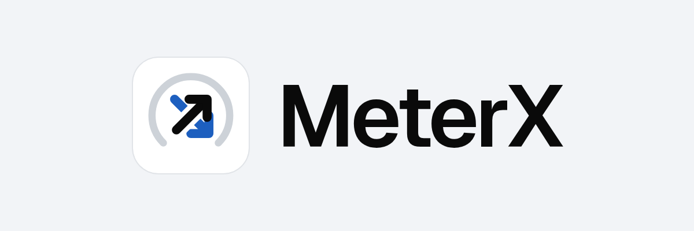
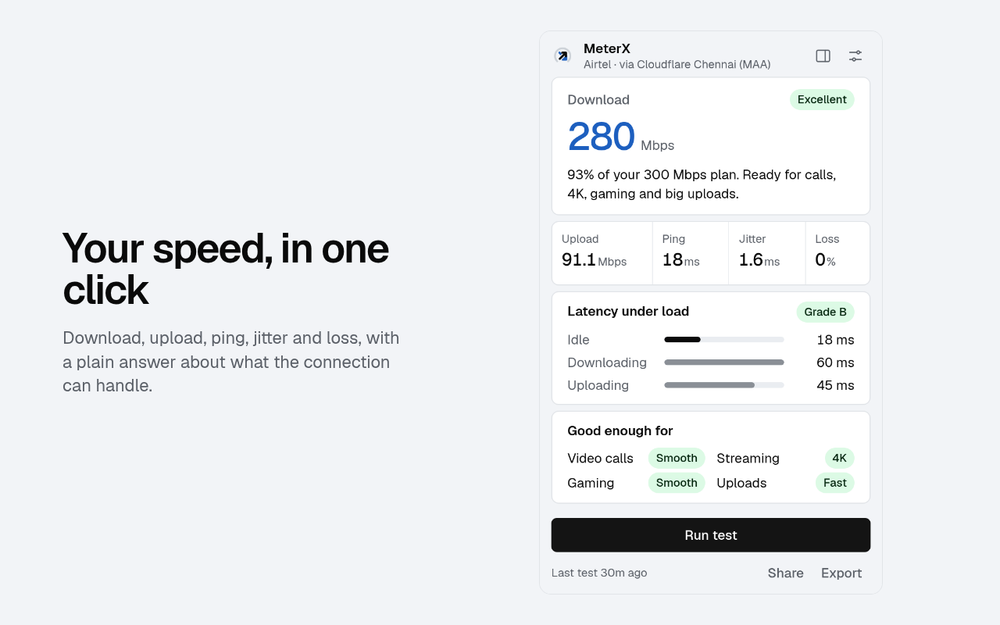

<div align="center">

<picture>
  <source media="(prefers-color-scheme: dark)" srcset="brand/png/lockup-on-dark.png" />
  
</picture>

**A free, open-source speed test in your browser toolbar that also tells you what the numbers mean.**

[](https://github.com/ajithakdev/meterx/actions/workflows/ci.yml)
[](https://addons.mozilla.org/firefox/addon/meterx-by-ajithakdev/)
[](https://microsoftedge.microsoft.com/addons/detail/glkpolbkpachomgmmhdkmjnghejbhlfc)
[](https://github.com/ajithakdev/meterx/releases)
[](https://github.com/ajithakdev/meterx/stargazers)
[](LICENSE)

[Install](#install) · [Privacy](#privacy-and-data) · [How it works](#how-it-works) · [FAQ](#faq) · [Website](https://meterx.ajithakdev.com) · [Guide](RESOURCES-AND-GUIDE.md)

</div>

Most speed tests stop at a download number. MeterX also measures ping while your line is busy (bufferbloat, graded A to F) and says in plain words whether the connection is good enough for calls, 4K streaming, gaming and big uploads. That busy-line ping is usually why a video call stutters while someone else downloads a game.

MeterX is free, with no account, no ads and no tracking. Your results never leave your browser unless you share them. It is a community project and is not affiliated with Cloudflare, Mozilla, Microsoft, Opera or Google.

<p align="center">
  <picture>
    <source media="(prefers-color-scheme: dark)" srcset="brand/png/readme/screenshot-1-dark-1280x800.png" />
    
  </picture>
</p>

## Install

| Browser | Get it |
| --- | --- |
| Firefox | [Firefox Add-ons](https://addons.mozilla.org/firefox/addon/meterx-by-ajithakdev/) |
| Microsoft Edge | [Edge Add-ons](https://microsoftedge.microsoft.com/addons/detail/glkpolbkpachomgmmhdkmjnghejbhlfc) |
| Opera | Listing link coming soon |
| Chrome, Brave, Vivaldi | Planned; see the [FAQ](#faq) |

[meterx.ajithakdev.com/get](https://meterx.ajithakdev.com/get/) picks the right store for your browser. To check that it works, click the MeterX icon in the toolbar and press **Run test**; a result appears in about 20 seconds.

## Features

- Download, upload, ping, jitter and packet loss, with 4 download and 3 upload streams so one slow connection can't hide your real speed.
- Latency under load, graded A to F, plus a plain answer for calls, streaming, gaming and uploads.
- History of up to 200 results in the side panel, with a trend chart and how much of your ISP plan actually arrives.
- Scheduled tests every 30 minutes, 2 hours or day, with an optional notice when quality drops to Poor.
- A PDF report with a report ID that stops matching if someone edits the numbers, plus CSV and JSON with units in every column.
- Share links that carry the whole result inside the link.
- Light, dark or match-system appearance, and your own test server if you'd rather not use the default.

## Privacy and data

| Area | What happens |
| --- | --- |
| Storage | Settings sit in your browser's sync storage and history in local storage (200 results at most). |
| Network | Tests talk only to the test server: by default a Cloudflare Worker that streams bytes and stores nothing. Like any server, it sees your IP address; it uses Cloudflare's request data to label results with your ISP and nearest location. |
| Permissions | `storage`, `alarms` (scheduled tests), `notifications` (quality notice), `sidePanel`, and access to the default server only. A custom server asks for permission when you add it. |
| Telemetry | None. No analytics, no account, no ads. |
| Sharing | A share link puts the result after the `#` in the URL, and browsers never send that part to a server. The page at meterx.ajithakdev.com/r/ reads it in your browser. |
| Checked | Every store upload goes through [docs/STORE-CHECKLIST.md](docs/STORE-CHECKLIST.md): Mozilla's linter, a reproducible build and a manual run in Firefox and Chromium. |

The full policy is at [meterx.ajithakdev.com/privacy](https://meterx.ajithakdev.com/privacy/).

## How it works

1. Ten quick pings to the server measure idle latency, jitter and packet loss.
2. Four parallel streams download for 8 seconds. The first 1.2 seconds (TCP ramp-up) and the last half second are trimmed, so the number is your steady speed.
3. Three parallel streams upload for 8 seconds, trimmed the same way.
4. While each transfer runs, MeterX keeps pinging. The rise over idle latency sets the bufferbloat grade.
5. The result is saved in your browser, and the toolbar badge shows the download speed in its quality color.

## FAQ

**Why isn't it on the Chrome Web Store?**
Chrome charges a developer registration fee and MeterX earns nothing, so it waits for now. Brave, Vivaldi and Chrome can load the Chromium zip from the [latest release](https://github.com/ajithakdev/meterx/releases/latest) as an unpacked extension.

**Why is my result different from another speed test?**
Each test uses its own servers and method. MeterX tests against the nearest Cloudflare location and trims the slow start, so it can read higher than tests that average the whole run, and lower than tests that report a peak.

**The popup's colors don't match my browser's theme.**
Some browsers, Firefox among them, tell extensions the system's light or dark setting instead of the browser's own. Pick Light or Dark under Appearance in MeterX settings.

**The popup looks bigger in one browser than another.**
The popup is 360 pixels wide in every browser. Each browser scales pixels to your screen in its own way, so it matches the rest of that browser.

**Can I use my own server?**
Yes. Run `npm start` from this repo (Express, port 3000) or deploy `services/worker` to your own Cloudflare account, then add it under Custom server in settings. Remote servers need https; plain http works for localhost and `.local` names.

More fixes are in the [guide](RESOURCES-AND-GUIDE.md#when-something-goes-wrong).

## Contributing

```bash
git clone https://github.com/ajithakdev/meterx.git && cd meterx && npm install
npm run dev:ext                  # build the extension, run a local test server on :8787
npm run lint && npm test         # what CI runs, plus the docs check
```

[CONTRIBUTING.md](CONTRIBUTING.md) covers loading the extension, the project layout and the rules a pull request follows. There are [good first issues](https://github.com/ajithakdev/meterx/labels/good%20first%20issue), and questions go to [Discussions](https://github.com/ajithakdev/meterx/discussions). Report security problems privately as [SECURITY.md](SECURITY.md) describes.

## Credits

Made and maintained by Ajith Kumar K ([@ajithakdev](https://github.com/ajithakdev)). The Geist font is by Vercel under the SIL Open Font License.

## License

[AGPL-3.0](LICENSE). The MeterX name and logo have their own rules in [TRADEMARK.md](TRADEMARK.md). Firefox, Edge, Opera, Chrome and Cloudflare are trademarks of their owners.
